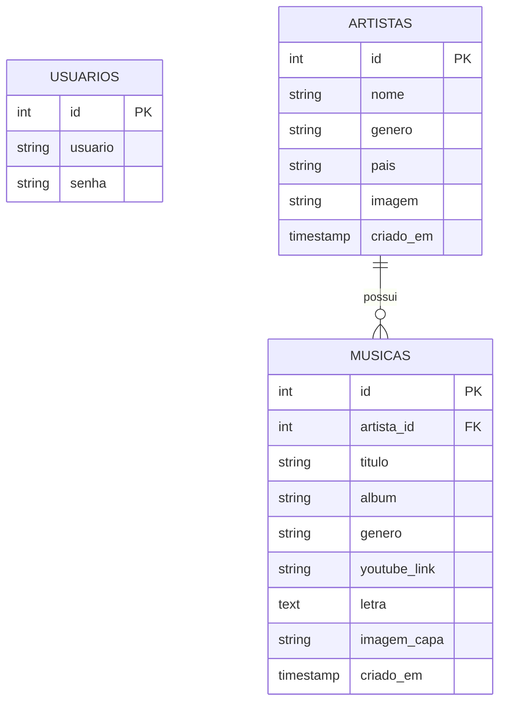

<div align="center">

<!-- BANNER DE BOAS-VINDAS & EFEITO DE ESCRITA -->


# 🌸 ✨ Sistema Musical ✨ 🌸
### *Gerenciador de Artistas & Músicas*

<!-- EFEITO DE DIGITAÇÃO DINÂMICO (DIGITA E APAGA SOZINHO) -->
<a href="https://github.com">
  
</a>

<br><br>

<!-- BADGES AESTHETIC -->


---

</div>

> 🎀 *Uma aplicação web moderna, segura e minimalista criada para organizar sua biblioteca musical com máxima elegância e sofisticação.* 🎀

<br>

## 🌷 ✦ Sobre o Projeto

O **Sistema Musical** é um software completo desenvolvido em **PHP** e **MySQL** projetado para gerenciar e catalogar artistas, álbuns e faixas musicais.

O sistema conta com tratamento automático de fotos de capa através da biblioteca **GD**, validações rigorosas de segurança contra ataques **CSRF**, hash de senhas via **BCrypt** e player integrado para o **YouTube**.

<br>

## ✨ ✦ Funcionalidades Principais

| Ícone | Funcionalidade | Descrição |
| :---: | :--- | :--- |
| 🔑 | **Autenticação Segura** | Sistema de Login contra CSRF, proteção de rotas e hashes `BCrypt`. |
| 🎤 | **Gestão de Artistas** | Cadastro, edição e remoção de artistas com upload de fotos otimizadas. |
| 🎧 | **Biblioteca de Músicas** | Vinculação de faixas com suporte a letras, álbuns e capas personalizadas. |
| ▶️ | **Player YouTube** | Detecção e execução de links de vídeos diretamente da plataforma. |
| 🔍 | **Filtros Dinâmicos** | Busca em tempo real por nome de faixa, artista, álbum ou gênero musical. |
| 🖼️ | **Smart Image Resizer** | Redimensionamento automático via PHP GD para $300 \times 300\text{ px}$. |

<br>

## 💖 ✦ Tecnologias & Ferramentas

```
 🌸 PHP 8.x        ──► Lógica de Negócio, Sessões & Segurança
 🪞 MySQL          ──► Armazenamento Relacional & FK Constraints
 🩰 HTML5 & CSS3   ──► Design Clean Girl & Componentes Responsivos
 🌷 PHP GD         ──► Processamento & Crop Inteligente de Fotos
```

<br>

## 🗄️ ✦ Arquitetura do Banco de Dados



<br>

## 🚀 ✦ Como Executar o Projeto Localmente

<details>
<summary><b>📋 Clique para expandir os passos de instalação</b></summary>

<br>

### 1️⃣ Pré-requisitos
* Servidor Web local (**XAMPP**, **WAMP**, **Laragon** ou PHP Built-in Server).
* **PHP 7.4+** com extensões `mysqli` e `gd` habilitadas.
* Servidor **MySQL** em execução.

### 2️⃣ Banco de Dados
Acesse o **phpMyAdmin** e crie a base executando o script `bd.sql`:

```sql
CREATE DATABASE IF NOT EXISTS sistema_musical_v2 
  CHARACTER SET utf8mb4 
  COLLATE utf8mb4_unicode_ci;
```

### 3️⃣ Acessar a Aplicação
> **URL:** `http://localhost/sistema_musical/login.php`  
> * **Usuário:** `admin`  
> * **Senha:** `123`  

</details>

<br>

## 📁 ✦ Estrutura do Projeto

```text
📂 sistema-musical/
 ├── 📄 bd.sql                 ── Script de banco de dados
 ├── 📄 conexao.php            ── Conexão MySQLi segura
 ├── 📄 funcoes.php            ── Helpers, GD Upload & CSRF
 ├── 📄 valida_sessao.php      ── Middleware de autenticação
 ├── 📄 login.php              ── Autenticação de usuários
 ├── 📄 logout.php             ── Encerramento de sessão
 ├── 📄 index.php              ── Dashboard Principal
 ├── 📄 cadastro_artista.php   ── Módulo de Artistas
 ├── 📄 cadastro_musica.php    ── Módulo de Músicas
 ├── 📄 listagem_musicas.php   ── Biblioteca & Filtros
 ├── 📄 geraSenha.php          ── Utilitário BCrypt
 └── 📂 img/                   ── Repositório de imagens
```

<br>

<!-- CARD DE CRÉDITOS ESPECIAL -->
<div align="center">


### 🌸 **Samilly Matos Barranova** 🌸
*Engenharia de Software & Web Development com Estética e Precisão.*

💖 **Se este projeto te inspirou, não se esqueça de deixar uma estrela!** 🎀

</div>
